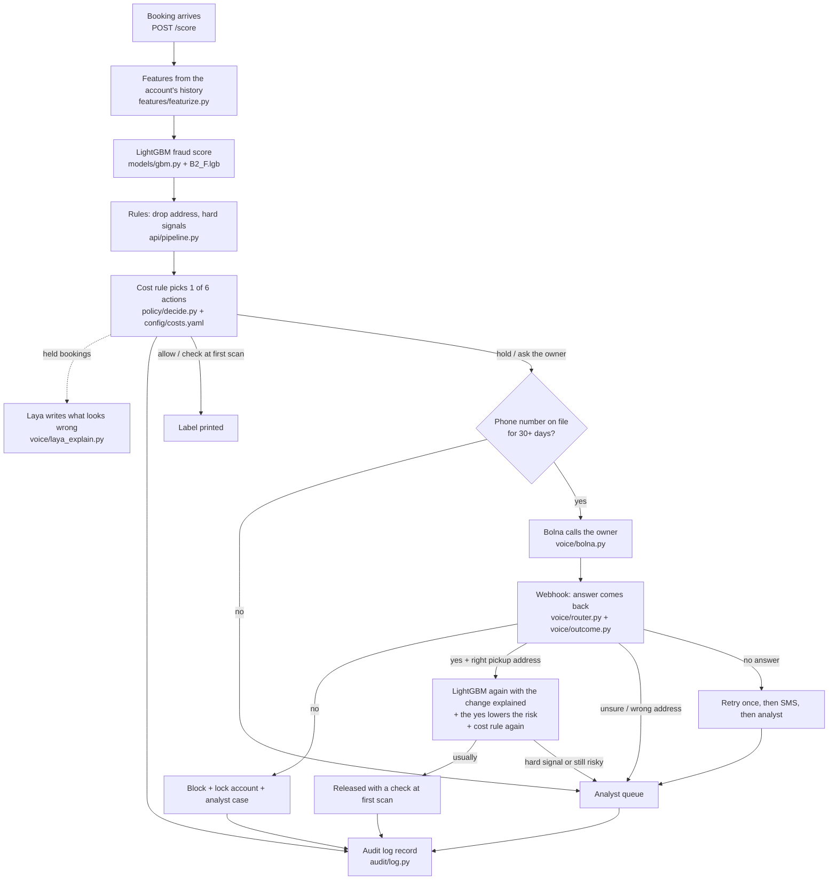

# How Tracd works, step by step (beginner's guide)

This guide follows one booking from the moment it is made to the final decision, and says which file does each step.
The same steps are in the app under **How it works** in the sidebar.

## The big picture



## Who does what

| Part | What it is | Does it decide? |
|---|---|---|
| **LightGBM** | A gradient-boosted tree model trained on 71 behaviour features. Returns a fraud probability in a few ms. File: `artifacts/models/B2_F.lgb`, code: `fraudshield/models/gbm.py`. | **Yes.** Every score you see as "Risk" comes from it. |
| **Laya** | A language model (ModernBERT-large, 421M parameters) fine-tuned to answer four yes/no fraud questions. Code: `fraudshield/models/laya_client.py`, `fraudshield/voice/laya_explain.py`. | **No, it explains.** It writes "what looks wrong" in plain English for every held booking. It lost to LightGBM on the held-out test (PR-AUC 0.356 vs 0.777, `artifacts/results_laya_v2.md`), so `config/app.yaml` sets `laya.decide: false`. Without `LAYA_API_KEY` the app shows labelled demo text instead. |
| **Rules** | Fixed checks: reshipping-drop receiver, link to confirmed fraud, account locked by its owner. `fraudshield/api/pipeline.py` | Only "hard signals" may block. |
| **Cost rule** | Adds up the expected cost of each of 6 actions and picks the cheapest allowed one. `fraudshield/policy/decide.py`, numbers in `config/costs.yaml` (all assumptions, labelled). | **Yes**, it turns the score into an action. |
| **Bolna voice agent** | Calls the account owner in English and asks "Was this you?". `fraudshield/voice/`. | The owner's answer feeds back into LightGBM and the cost rule. |
| **Audit log** | Append-only file where every record carries the previous record's hash. `fraudshield/audit/log.py`. | No, it records. |

## Part 1: when a booking is made (under 300 ms)

1. **A booking arrives.** `POST /score` in `fraudshield/api/app.py`. Account, sender, from, to, weight, size, service, price,
   login device. Nothing is printed yet.
2. **Features.** `fraudshield/features/featurize.py` reads the account's own past bookings from the feature store
   (`data/processed/feature_store_demo.parquet`), only bookings from before this one, and computes about 70 numbers:
   new senders the account pays for, cost compared with its usual cost (`cost_vs_median`), weight compared with its
   usual weight (`weight_z`), login device age, booking hour, how many other accounts ship to the same receiver.
3. **LightGBM score.** `fraudshield/models/gbm.py` loads `artifacts/models/B2_F.lgb` and returns a probability of
   fraud from 0 to 1, calibrated with Platt scaling (0.9 means about 9 in 10 such bookings are fraud).
4. **Laya explains.** For every held booking, `fraudshield/voice/laya_explain.py` asks Laya its four yes/no
   questions and writes the yes-answers as plain sentences ("Someone other than the owner may be using this
   account."). Laya does not decide (`laya.decide: false`): LightGBM's score does. Answers come from the live
   fine-tuned Laya (`LAYA_API_KEY` + `laya.http_url`), else from real cached Laya answers, else from clearly
   labelled **demo text** built from the booking's own facts. The **Laya model** page shows the fine-tuning runs
   and the test scores.
5. **Rules.** `default_rules()` in `fraudshield/api/pipeline.py`. A drop-address pattern raises the risk; a hard signal
   allows a block.
6. **Cost rule.** `fraudshield/policy/decide.py`. For each action it computes
   `(1 - p) x cost if honest + p x cost if fraud` and picks the cheapest one that is allowed. The 6 actions:
   allow, allow with a check at the first depot scan, ask the owner, analyst review, hold, block.
7. **Audit.** The decision is appended to `artifacts/audit/audit.jsonl` with its hash.

Measured speed: see `artifacts/results_system.md` and the latency in the top bar of the app.

## Part 2: Tracd Verify, when a booking is held (about 1 to 2 minutes)

Code: `fraudshield/voice/`. It starts automatically for every booking whose action is **hold** or **ask the owner**.

8. **Check the number.** `service.py start()`. The owner's number comes from `config/owners.yaml` (the real number is
   in `.env`, never in the repo). If it changed in the last 30 days there is **no call** (a fraudster who changed the
   number would confirm his own booking): the booking goes to an analyst.
9. **The call.** `bolna.py` sends `POST https://api.bolna.ai/call` with the agent id, the owner's number, the language
   (`agent_data.language`) and the booking details as variables. The agent says it never asks for OTPs, passwords
   or card numbers, reads out the booking and asks "Was this you?". On yes it asks the pickup address and whether
   anything changed.
   *No Bolna key, no number, or the call failed?* A simulated call runs the same steps (`script.py`) and is labelled
   **simulated** everywhere.
10. **The answer comes back.** Bolna posts each call status to `POST /voice/webhook?token=...` (`router.py`). While a
    real call runs, the app also polls `GET /executions/{id}`, so it works even without a public webhook.
    `outcome.py` reads `owner_confirmed`, `detail_answer`, `change_reason`, `language`. The same message twice is
    applied once.
11. **Decide again.** `service.py _on_answered()`:
    - **No:** block, lock the account (its next bookings get a hard signal), open an analyst case with the
      transcript, and record the label "fraud" for the learning loop.
    - **Yes, and the pickup address matches:** `pipeline.rescore_after_owner()`:
      the features the stated change explains (new warehouse: new sender and new origin; new staff login: new
      device) are set to normal values (`damping.py`) and **LightGBM scores again**; then the "yes" lowers the
      odds by `P(yes | fraud) / P(yes | honest)` = 0.10 / 0.95 (assumptions); then the **cost rule runs again** with
      "check at first scan" as the minimum. The change stays "known" for 30 days for the same warehouse only.
      A **hard signal** is never released by a yes.
    - **Unsure, wrong address, or still risky:** stays held, analyst decides.
    - **No answer:** one retry, then an SMS (a stub in this prototype: logged, not sent), then the analyst.
      Never released automatically.
12. **Audit.** Every step is a new record that points to the decision id and the decision's hash. The decision is
    never edited. `GET /audit/verify` (or `python -m fraudshield.audit verify --path artifacts/audit/audit.jsonl`)
    checks the whole chain.

## Part 3: done before the app runs (training)

- **Data:** `scripts/build_dataset.py`. Real Olist bookings, plus an invented layer (accounts, logins, devices,
  billing), plus about 1% injected fraud in 7 patterns. Split by time: train, calibration, test
  (15 May to 31 Aug 2018). Two fraud patterns (T3, T5) never appear in training.
- **LightGBM:** `scripts/train_gbm.py` writes `artifacts/models/B2_F.lgb`. Results in `artifacts/results_gbm.md`
  (PR-AUC 0.777 on the test window, mean of 10 seeds).
- **Laya:** `scripts/laya_train.py` (run on a Kaggle GPU). Results in `artifacts/results_laya_v2.md`: it did not beat
  LightGBM, so LightGBM keeps deciding.
- **Learning loop:** `fraudshield/learning/`. Analyst labels and owner "no" answers become new labels; a retrain is
  deployed only if it passes the gate in `docs/LEARNING_GATE.md` (Learning page).

## What you see in the app

| Page (sidebar) | What it shows |
|---|---|
| **Owner calls** (home page) | Real bookings from the test window (never trained on), scored live at startup. Held ones get a simulated call whose answer is the dataset's own label. Tabs: Real bookings, Analyst cases, Demo scenarios. Click a booking to read "What happened"; "Technical details" holds the scores, costs, timeline and audit hashes. |
| **Owner calls, Demo scenarios** | The three scripted bookings for the video (fraud at 2:14 am, honest new warehouse, number changed 6 days ago). Same model, same call logic. |
| **Try a booking** | Score any booking by hand. A held one starts a call automatically. |
| **Audit log** | Chain check and the records. |
| **How it works** | This guide. |
| **More tools** (collapsed) | The earlier FraudShield screens: last decision in depth, model dashboard, review queue, live stream replay, learning loop, red team. Kept, just out of the way. |

## Running it

```
cd F:\PROJECTS\fraud-shield\fraudshield
%USERPROFILE%\.venvs\fraudshield\Scripts\python.exe -m uvicorn fraudshield.api.app:create_app --factory --port 8080
```

Open http://localhost:8080/#/verify. For real calls, put `BOLNA_API_KEY`, `BOLNA_AGENT_ID` and your verified phone
numbers in `.env` and restart.

## Real, invented, simulated

- **Real:** Olist bookings (dates, places, weights, prices), the trained LightGBM, every score and cost on screen.
- **Invented:** account logins, devices and billing, and the injected fraud rows.
- **Simulated (yellow label):** owner calls without a Bolna key or a real number; the owner's answer then comes from
  the dataset label or the demo script.
- **Demo labels:** the Indian city and company names on the three demo scenarios; the data underneath is Olist.
